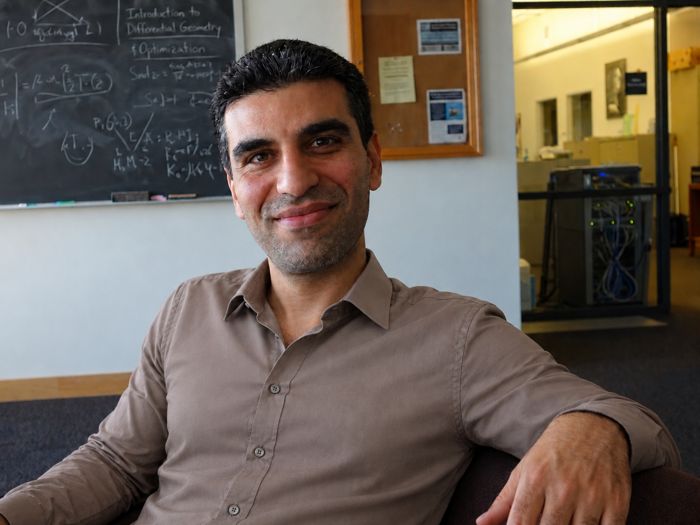

::: {.home-shell}
::: {.home-grid}

::: {.home-copy}

## Bio

I am a Professor of Mathematics at Kansas State University.

My research focuses on nonlocal models, peridynamics, numerical analysis, spectral methods, and mathematical questions connected with scientific computing and artificial intelligence.

I use this site to collect my research, publications, presentations, writings, and ongoing projects.

## Selected Projects

### Nonlocal Models and Peridynamics

Analysis and numerical methods for nonlocal equations, with emphasis on regularity, discontinuities, and spectral approximation.

### AI, Mathematics, and Scientific Discovery

Exploring how AI can support mathematical research, scientific knowledge representation, verification, and new models of scientific communication.

### Scientific Knowledge Infrastructure

Ideas and prototypes for representing scientific claims, dependencies, evidence, and research trajectories in forms that are more useful to both people and AI.

:::

::: {.profile-panel}

{.profile-photo}

# Bacim Alali

Professor of Mathematics  
Kansas State University

::: {.profile-links}
[GitHub](https://github.com/bacim-alali){.profile-button}
[Email](mailto:YOUR_EMAIL_HERE){.profile-button}
[CV](cv.html){.profile-button}
[Blog](blog/index.html){.profile-button}
:::

:::

:::
:::
